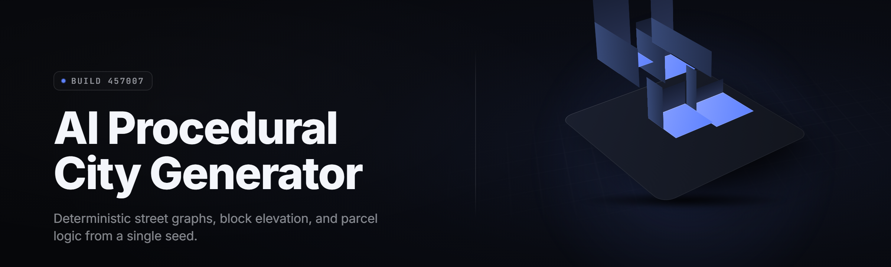

  
  
  

  

  
  
  

---

**procedural-city-generator** — an AI procedural city generator for Windows that turns a text prompt, a seed, or a road graph into a fully populated, traffic-ready city block in seconds.

---

## 🏙️ Table of Contents

- [🏙️ Table of Contents](#️-table-of-contents)
- [🧭 What is the AI procedural city generator?](#-what-is-the-ai-procedural-city-generator)
- [🔧 Compatibility & Platform Support](#-compatibility--platform-support)
- [🧩 The Problem](#-the-problem)
- [🛣️ The Solution](#️-the-solution)
- [📦 Installation](#-installation)
- [🚦 Quick Start](#-quick-start)
- [🧱 Overview](#-overview)
- [🏗️ City Generation Modules](#️-city-generation-modules)
- [⚙️ System Requirements](#️-system-requirements)
- [🎛️ Hotkeys](#️-hotkeys)
- [🐞 Known Issues](#-known-issues)
- [❓ FAQ](#-faq)

---

## 🧭 What is the AI procedural city generator?

The AI procedural city generator is a standalone Windows `.exe` that builds entire urban environments — roads, zoning, buildings, props, traffic, and lighting — from a single prompt or seed. It runs a diffusion-guided layout model on top of a constraint solver, so the output is not random noise: it is a city that obeys the rules you set.

| Term | Explanation |
| --- | --- |
| **Prompt** | Free-text description of the city you want (e.g. "foggy coastal port, dense mid-rise, tram lines"). |
| **Seed** | Integer that locks the RNG stream — same seed, same city, every time. |
| **Block graph** | The solver's internal map of intersections, parcels, and frontage before geometry is emitted. |
| **Zoning mask** | Painted or prompt-derived regions that force residential / commercial / industrial density. |
| **Tile set** | The building + prop library the generator samples from when dressing parcels. |
| **Bake** | The final export pass that flattens the generated city into a mesh or scene file. |
| **LOD ladder** | Auto-generated distance tiers (LOD0–LOD4) so the city runs at interactive framerate. |

Core benefits:

- One prompt produces a walkable, drivable city in under 30 seconds on a mid-range GPU.
- Deterministic seeds mean your test team gets the *same* city, every build.
- Exports straight to Unity, Unreal, Godot, and `.obj` / `.gltf` / `.fbx`.
- Zoning, traffic density, and time-of-day are all live-editable before you bake.
- No internet connection required after first launch — the model runs locally.

---

## 🔧 Compatibility & Platform Support

| Platform | Support | Notes |
| --- | --- | --- |
| Windows 10 (21H2+) | ✅ Full | Requires DirectX 12 GPU. |
| Windows 11 | ✅ Full | Recommended target. |
| Windows Server 2022 | ⚠️ Partial | No live preview, headless bake only. |
| Wine / Proton | ⚠️ Partial | Runs, but preview window stutters. |
| macOS / Linux | ❌ None | Native ports not planned for 2026. |

---

## 🧩 The Problem

Hand-building a city for a game, a sim, or a film previz is brutal. The pain points are specific:

- Blocking out a single dense district by hand eats **40–120 hours** of level design time.
- Random scatter tools produce cities that look fine from a distance and **fall apart the moment you walk a street**.
- Traffic, parking, and crosswalk logic almost never line up with the geometry you placed by hand.
- Iterating on "make it denser" or "make it rainier" means re-doing the whole block.
- Hand-built cities don't have **deterministic seeds**, so QA can't reproduce a bug.
- Exporting to a game engine usually means a one-way trip — no round-trip editing.
- Props and signage are an afterthought, so streets read as empty and fake.

---

## 🛣️ The Solution

| Problem | Solution |
| --- | --- |
| 40–120 hours of blocking | One prompt + seed generates a full district in <30s. |
| Distance-only looks | Diffusion-guided layout produces street-level believable frontage. |
| Traffic geometry mismatch | Roads, lanes, and signals are generated from the same graph. |
| Slow iteration | Live regeneration — tweak density, weather, time-of-day instantly. |
| No reproducibility | Every city is seed-locked and hash-verified. |
| One-way exports | Round-trip: re-import a baked scene and keep editing zoning. |
| Empty streets | 2,800+ prop and signage assets auto-placed by parcel type. |

---

## 📦 Installation

1. **Download the package.** Grab the latest Windows archive from the project page. The `.exe` is self-contained — no Python, no Node, no installer scripts.
2. **Extract.** Right-click the archive → *Extract All* → pick a folder *outside* `Program Files` so the model cache can write without elevation.
3. **Run.** Double-click the `.exe`. On first launch it unpacks the 1.4 GB model weights into `%LOCALAPPDATA%\procedural-city-generator\models\`. Subsequent launches skip this step.

> First run may take 30–60 seconds while the model cache warms. Later launches are instant.

---

## 🚦 Quick Start

1. 🏁 **Launch the `.exe`** and wait for the viewport to open.
2. ✍️ **Type a prompt** in the top bar — e.g. `dense neon mid-rise, riverside, heavy traffic`.
3. 🎚️ **Set zoning + density sliders** on the right panel.
4. 🎲 **Pick a seed** (or hit *Random*). Note the hash shown under the seed field.
5. 💾 **Bake & export** to `.obj`, `.gltf`, `.fbx`, or a native engine scene.

  

---

## 🧱 Overview

| Category | Details |
| --- | --- |
| **Engine** | Local diffusion-guided layout model + constraint solver |
| **Input** | Prompt text, seed, zoning masks, road graphs (`.osm`, `.graphml`) |
| **Output** | `.obj`, `.gltf`, `.fbx`, Unity `.unitypackage`, Unreal `.uasset` bundle |
| **Runtime** | GPU-accelerated (DirectX 12 / Vulkan backend), CPU fallback |
| **Model size** | ~1.4 GB on disk, loaded into VRAM on demand |
| **Determinism** | Seed-locked, hash-verified per bake |
| **Edition** | Windows desktop, 2026 release line |

The generator separates *layout* (where things go) from *dressing* (what things look like), so you can re-roll the dress pass on an existing layout without regenerating the whole city. That split is what lets the tool stay interactive at city scale.

---

## 🏗️ City Generation Modules

| Module | Status | Description |
| --- | --- | --- |
| Terrain Sculptor | ✅ Working | Heightfield + river carving from prompt or imported DEM. |
| Road Graph Solver | ✅ Working | Generates lane-accurate intersection topology. |
| Zoning Painter | ✅ Working | Brush-tool masks for `residential / commercial / industrial / park`. |
| Parcel Subdivider | ✅ Working | Splits blocks into buildable lots with frontage logic. |
| Building Massing | ✅ Working | Extrudes lots into mass with setbacks and floor counts. |
| Facade Weaver | ✅ Working | Applies window, sign, and AC-unit patterns per street class. |
| Roof Detailer | ✅ Working | Water tanks, HVAC, billboards, vents, rooftop decks. |
| Signage Typographer | ✅ Working | Prompt-consistent storefront text (safe, non-trademark). |
| Traffic Simulator | ✅ Working | Car + tram agents routed on the generated lane graph. |
| Pedestrian Dressing | ✅ Working | Crowd density tied to zoning and time-of-day. |
| Lighting Rig | ✅ Working | Streetlights, neon, window emission, and dusk grading. |
| Weather Layer | ✅ Working | Fog, rain, wet-road reflections, snow coverage. |
| Prop Scatter | ✅ Working | Benches, bins, hydrants, awnings, planters, cables. |
| Vegetation Solver | ✅ Working | Street trees, parks, planters, procedural hedges. |
| Rail & Tram Builder | ✅ Working | Overhead lines, platforms, depot lots. |
| Highway Kit | ✅ Working | On-ramps, overpasses, gantries, guardrails. |
| Waterfront Kit | ✅ Working | Piers, docks, cranes, container stacks, buoys. |
| LOD Ladder | ✅ Working | Auto LOD0–LOD4 with screen-size budget targeting. |
| Collision Proxy | ✅ Working | Simplified colliders generated alongside full mesh. |
| Navmesh Prelight | ✅ Working | Pre-baked navmesh for engine import. |
| Unreal Bridge | ✅ Working | Instanced static mesh + `.uasset` bundle export. |
| Unity Bridge | ✅ Working | Prefab-per-parcel `.unitypackage` export. |
| Godot Bridge | ✅ Working | Scene + resource export for Godot 4.x. |
| Seed Hasher | ✅ Working | SHA-style seed hash printed on every bake for QA. |

---

## ⚙️ System Requirements

| Component | Minimum | Recommended |
| --- | --- | --- |
| OS | Windows 10 21H2 | Windows 11 23H2+ |
| CPU | 4-core / 3.0 GHz | 8-core / 3.8 GHz+ |
| RAM | 16 GB | 32 GB |
| GPU | DirectX 12, 6 GB VRAM | 12 GB VRAM, RT-capable |
| Disk | 6 GB free (SSD) | 20 GB free (NVMe) |
| VRAM (bake) | 4 GB | 8 GB |
| VRAM (preview) | 3 GB | 6 GB |

---

## 🎛️ Hotkeys

| Key | Action |
| --- | --- |
| `G` | Regenerate city with current settings |
| `R` | Re-roll dress pass only (keep layout) |
| `Z` | Toggle zoning brush |
| `F` | Frame the whole city |
| `Tab` | Cycle LOD preview |
| `Ctrl+S` | Bake & export |
| `Ctrl+Z` | Undo slider change |

---

## 🐞 Known Issues

| Issue | Solution |
| --- | --- |
| First launch slow | Model cache is unpacking — wait 30–60s, subsequent runs are instant. |
| Preview stutters at high density | Drop the LOD preview to `1` in the viewport bar. |
| Export fails with `.fbx` write error | Ensure export folder is writable and not under `Program Files`. |
| Traffic agents clip on tight intersections | Tighten lane width in the road panel, then regenerate. |
| Zoning brush not painting | Confirm the brush layer is selected — press `Z`. |
| Engine bridge export shows pink materials | Re-import with the texture folder inside the export bundle. |

---

## ❓ FAQ

Does it work offline?

Yes. The model weights ship inside the archive and load from the local cache. No internet is needed after first launch.

Can I reproduce the exact same city later?

Yes. Every city is seed-locked. Note the seed and the printed hash on bake, then re-enter them to regenerate identically.

Is it a standalone .exe or does it need Python?

Standalone. The `.exe` is self-contained — no Python, no Node, no external runtimes.

Which engines can I export to?

Unity, Unreal, and Godot have first-class bridges. Generic `.obj`, `.gltf`, and `.fbx` export works for everything else.

Can I edit an already-baked city?

Yes. Re-import a baked scene and the zoning and dress layers stay editable; layout edits require a regenerated road graph.

Does it run on a laptop GPU?

Yes, with preview reduced. On 6 GB VRAM cards, drop density and disable real-time traffic agents for smooth preview.

Can I import a real road graph?

Yes. `.osm` and `.graphml` graph imports feed directly into the road solver as a seed layout.

How large can a single city get?

Cities up to roughly 8 km² generate cleanly on recommended hardware. Beyond that, split the map into districts.

Is the output licensed for commercial games?

The generated geometry is yours to ship. The bundled base tile set is MIT-licensed — check individual prop packs for their own terms.

Why is my first city taking a while?

Model warmup plus cache unpack. Once complete, regeneration on the same machine stays under 30 seconds at mid density.

---

## 🚧 Denser Districts, Cleaner Seeds

The AI procedural city generator exists to kill the copy-paste district — the same six blocks tiled to infinity. Prompt it, seed it, bake it, and the city that comes out is one you can actually walk. Round-trip it through your engine, re-roll the dress pass until the signage reads right, and lock the seed so QA can hand you a repro build instead of a bug report that says "it happened in the city somewhere." That is the whole point of the tool — density with intent, and a seed you can hand to the next person on the team.

  

